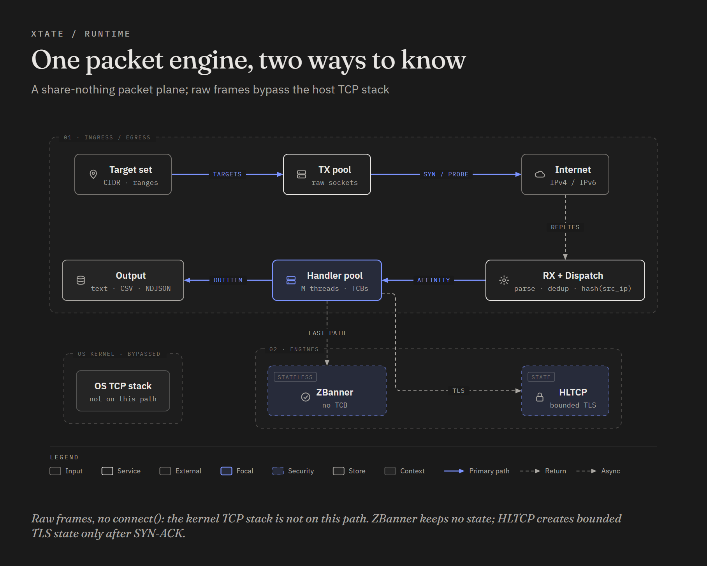
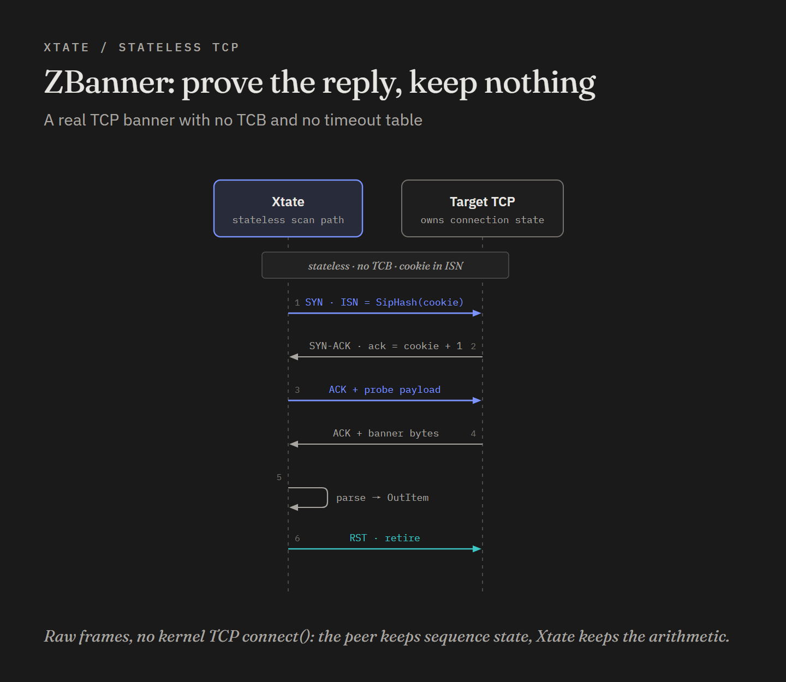
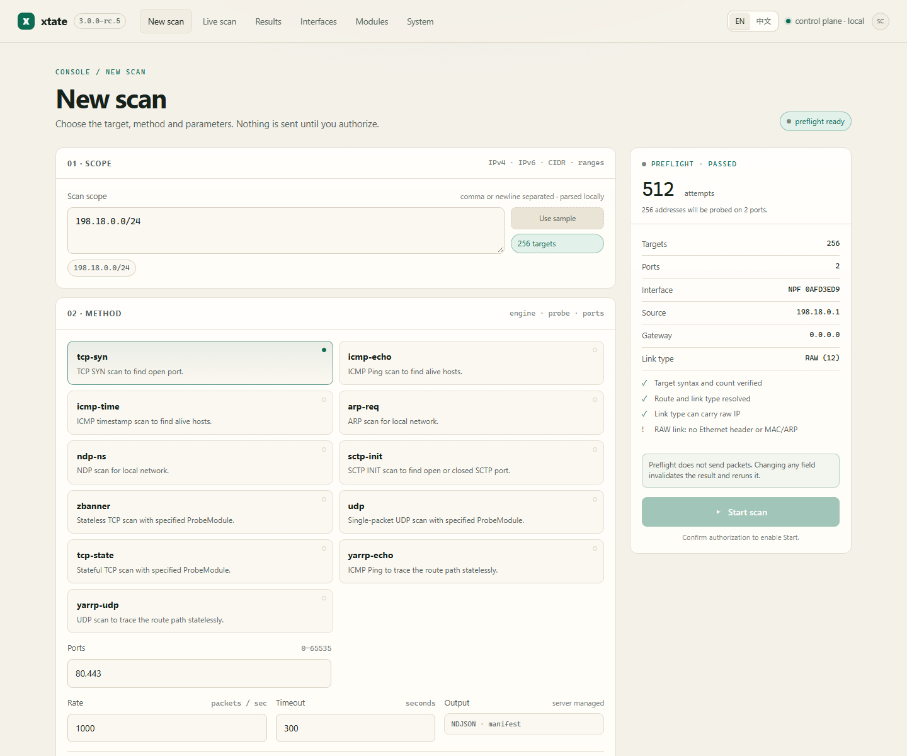

<div align="center">
  
  <br>

  <h3>Xtate — a modular all-stack scanner for professional Internet measurement</h3>

  <p>
    <b>English</b> · <a href="README.zh-CN.md">简体中文</a>
  </p>

  <p>
    <b>Stateless TCP banners.</b> <b>Hybrid-state TCP/TLS.</b>
    <b>84 modules in a full Linux build.</b> <b>CLI, GUI and MCP.</b><br>
    <sub>C99 · Linux glibc/musl &amp; Windows · GCC/Clang/MSVC/MinGW · Make/Ninja · IPv4 &amp; IPv6</sub>
  </p>

  <p>
    <a href="https://github.com/babycoff/xtate"></a>
    <a href="LICENSE"></a>
    <a href="https://github.com/babycoff/xtate"></a>
    <a href="https://github.com/babycoff/xtate"></a>
    <a href="https://github.com/babycoff/xtate"></a>
    <a href="https://github.com/knownsec/404StarLink"></a>
    <a href="https://arxiv.org/abs/2405.07409"></a>
  </p>
</div>

> **God is Stateless.** — the Xtate proverb

Xtate is built for people who measure the Internet for a living: network and
security researchers, measurement-platform operators, and engineers who need
reproducible evidence at Internet scale. It is a packet engine, not a crawler:
**ZBanner** obtains real TCP responses without per-target connection state, and
**HLTCP** completes TLS handshakes and fetches HTTPS responses when statelessness
is not enough.

The **command line is the primary interface**. It is the most direct way to
express a target set, a scan/probe pairing, a rate, an output format and a
reproduction recipe, and it is the interface every other client uses underneath.
The browser console, MCP server and Agent Skill are additional ways to drive the
same engine — useful for exploration and automation, but not a replacement for
the CLI.

> **Linux prerequisite (not Windows):** `zbanner`, `tcp-state`, `tls-state` and every state
> sub-probe require `sudo ./firewall/add_rules.sh` on the scanner host before
> scanning (not `tcp-syn`/stateless port scans). Missing rules produce `open` with no banner/TLS/probe output.
> See [Linux firewall](./docs/firewall.md).

> [!WARNING]
> Xtate sends raw packets. Scan only networks you own or have explicit written
> permission to test. Unauthorized scanning may be illegal where you live.
> You are responsible for the rate you send and for the targets you choose.

> **3.0 release candidate.** The 3.0 line adds a scan-first browser console, a
> one-command MCP server, a bilingual manual, explicit protocol capability
> reporting, and a stronger CLI. It remains an RC until field trial is complete;
> 2.44.2 is the latest stable tag.

## Contents

- [Why measurement professionals use Xtate](#why-measurement-professionals-use-xtate)
- [Install and first scan](#install-and-first-scan)
- [The command line](#the-command-line)
- [How Xtate works](#how-xtate-works)
- [Scanning engines](#scanning-engines)
- [Modules](#modules)
- [Additional clients: GUI, MCP and Skill](#additional-clients-gui-mcp-and-skill)
- [Build](#build)
- [Platforms and toolchains](#platforms-and-toolchains)
- [Documentation](#documentation)
- [Research and citation](#research-and-citation)

## Why measurement professionals use Xtate

- **CLI-first, scriptable and reproducible.** One binary expresses the complete
  experiment: target space, module pairing, rate, output, resume point and
  metadata. `--echo` records the effective configuration; `--list-capabilities`
  reports what the build can actually do.
- **ZBanner: real TCP responses without a per-target table.** The peer's TCP
  stack holds the state; a SipHash cookie proves the reply belongs to this scan.
  This is the engine for Internet-wide banner censuses.
- **HLTCP: state only where it earns its keep.** A TCB is created after a
  SYN-ACK, then a user-space TCP/TLS conversation can collect certificates,
  ciphers and HTTP evidence without putting the host kernel on the path.
- **Protocol breadth with explicit capability reporting.** HTTP/1.0, HTTP/1.1,
  HTTP/2 (HPACK including Huffman), HTTP/3 over QUIC when the build supports it,
  TLS evidence, DNS/DNSSEC/DoT/DoH, JARM, SSH, mail, databases, industrial and
  IoT protocols. Windows honestly reports HTTP/3 and QUIC transport as
  unavailable instead of pretending.
- **Designed for large target spaces.** CIDR, ranges, component ranges, excludes,
  ASN input, streamed files, BlackRock permutation, sharding and resumable runs.
- **Bilingual by design.** Human-facing help is available in English and Chinese;
  the GUI and the manual follow the same split.

## Install and first scan

### Linux: build and run

```bash
git clone https://github.com/babycoff/xtate.git
cd xtate
sudo apt install build-essential cmake pkg-config libpcap-dev \
  libssl-dev libpcre2-dev libxml2-dev libbson-dev libmongoc-dev \
  libngtcp2-dev libngtcp2-crypto-gnutls-dev libgnutls28-dev libzstd-dev
./build.sh
sudo ./bin/xtate -ip 192.168.1.0/24 -p 80,443 -scan tcp-syn -rate 100
```

The first command is a stateless SYN scan and needs no firewall changes. For a
real banner-grabbing handshake, stop the Linux kernel from resetting connections
it does not know about:

```bash
sudo ./firewall/add_rules.sh
sudo ./bin/xtate -ip 192.168.1.0/24 -p 80,8080 \
  -scan zbanner -probe http -show info
sudo ./firewall/rm_rules.sh
```

> [!WARNING]
> **Linux firewall rules are mandatory for `zbanner` and every
> `tcp-state`/`tls-state`/state-probe scan.** They suppress the kernel RST that
> otherwise kills half-open connections. A missing rule often looks like `open`
> but produces no banner, no TLS output, or a state probe that times out. The
> rules are host-wide and drop every outgoing RST/ICMP-unreachable from the
> machine while active.

> [!TIP]
> Start at `-rate 100`, not `-rate 100000`. A lab subnet is not the Internet,
> and your switch will thank you.

On Windows, install [Npcap](https://npcap.com/), build with CMake, and run
`xtate.exe` from an elevated shell. Start with the
[Windows quick start](docs/windows-quickstart.md).

### Check the route before you send

```bash
./bin/xtate --list-if
./bin/xtate --explain-target 203.0.113.10
./bin/xtate --check -ip 203.0.113.0/24 -p 443
```

`--list-if` prints capture adapters with addresses, MAC, gateway and link type.
`--explain-target` shows which interface and source address a target will use;
`--check` performs the same read-only checks for a target set. Neither sends a
probe. On TUN/VPN adapters the link type may be `RAW`; `--explain-target` says
whether raw IP is supported and whether an Ethernet header/MAC is available.

### A few commands worth knowing

```bash
# Stateless TLS hello: ServerHello hints without a full handshake
sudo ./bin/xtate -ip 10.0.0.0/24 -p 443 -scan zbanner -probe tls-hello -show info

# Stateful TLS evidence: certificate, issuer, SAN, ALPN
sudo ./firewall/add_rules.sh
sudo ./bin/xtate -ip 10.0.0.0/24 -p 443 -scan tcp-state -probe tls-state -show info

# UDP DNS probe
sudo ./bin/xtate -ip 10.0.0.0/24 -p u:53 -scan udp -probe dns -show info

# LAN ARP sweep
sudo ./bin/xtate -ip 192.168.1.0/24 -scan arp-req -lan

# IPv6 neighbor discovery on a local link
sudo ./bin/xtate -ip fe80::1/120 -scan ndp-ns -src-ip fe80::2 -fake-router-mac

# SCTP INIT scan
sudo ./bin/xtate -ip 10.0.0.0/24 -p s:38412 -scan sctp-init -show info
```

## The command line

### Anatomy of a scan

```text
xtate [options] -ip TARGETS [-p PORTS] -scan SCANMODULE [-probe PROBEMODULE]
```

| Part | Meaning | Examples |
|:---|:---|:---|
| `-ip` | IPv4/IPv6 targets, ranges, CIDR or component ranges | `10.0.0.0/8`, `192.168.1.1-254`, `2001:db8:1-5::1` |
| `-p` | Ports; prefixes select the transport | `80,443`, `20-25`, `u:53`, `s:38412` |
| `-scan` | How packets are sent and what state is kept | `tcp-syn`, `zbanner`, `tcp-state`, `udp`, `icmp-echo` |
| `-probe` | L5+ payload and parser, when the scan requires one | `http`, `tls-state`, `dns`, `ssh`, `jarm` |
| `-rate` | Total packets per second across all TX threads | `100`, `0.1`, `100000` |
| `-show` | Result levels to print | `success`, `info`, `fail` |
| `-o` | Output module and file | `-o ndjson -output-file run.ndjson` |
| `-scan-arg` / `-probe-arg` | Module-specific parameters | `-scan-arg "-banner"` |

Run `xtate --usage` for a compact set of examples, `xtate --help` for every
global parameter, and `xtate --help-scan <module>` / `--help-probe <module>` /
`--help-out <module>` / `--help-gen <module>` for module parameters. The help
text is generated from the same metadata the parser uses, so it reflects the
build you are running.

### Common workflows

| Task | Command |
|:---|:---|
| Host discovery | `-ip 10.0.0.0/24 -scan icmp-echo` |
| Fast port scan | `-ip 10.0.0.0/24 -p 80,443 -scan tcp-syn` |
| Stateless banners | `-ip 10.0.0.0/24 -p 80 -scan zbanner -probe http` |
| TLS evidence | `-ip 10.0.0.0/24 -p 443 -scan tcp-state -probe tls-state` |
| UDP service probe | `-ip 10.0.0.0/24 -p u:53 -scan udp -probe dns` |
| Target inspection | `-ip 10.0.0.0/8 --list-target` |
| Target file | `-include-file targets.txt -scan tcp-syn -p 443` |
| Resume a run | `-ip 10.0.0.0/8 -p 443 -scan tcp-syn --resume-index N` |
| Machine-readable run | `-o ndjson -output-file run.ndjson` |

Targets and ports are covered in [Targets and ports](docs/targets-and-ports.md);
scan/probe pairings and recipes are in [Scanning modes](docs/scanning-modes.md);
result levels and formats are in [Output](docs/output.md).

### Make the run reproducible

```bash
./bin/xtate -ip 203.0.113.0/24 -p 443 -scan tcp-syn -rate 100 \
  --echo > experiment.conf
./bin/xtate --config-file experiment.conf
```

`--meta-filename` writes the effective interface, rate and version next to the
results. `--list-capabilities` is the machine-readable statement of what this
binary supports; use it in experiment logs and CI rather than assuming a module
or protocol is present.

### Interactive shell

```bash
./bin/xtate -interactive
```

No ncurses, no readline package, no Python/Go launcher. The shell provides
grouped `help`, tab completion for commands/parameters/modules/values/paths,
history, `set`, `show diff`, `show all`, `list-param`, and a deterministic
non-TTY script mode. It is convenient for exploration; scripts should prefer
the non-interactive CLI.

### Discover what this build can do

```bash
xtate --usage                  # short usage and examples
xtate --help                   # every global parameter
xtate --intro                  # architecture tour
xtate --list-capabilities      # JSON: module counts, HTTP/3, QUIC, zstd
xtate --list-scan              # 11, or 12 with quic-state on Linux
xtate --list-probe             # 59, or 60 with http3-state
xtate --list-out               # 7 output modules
xtate --list-gen               # 5 generate modules
xtate --help-scan zbanner      # module-specific parameters
xtate --lang zh --help         # Chinese help, English fallback where untranslated
```

## How Xtate works

<p align="center">
  
</p>

The packet path is target generation and TX on the ingress side, a merged
`RX + Dispatch` stage, then handlers and output. ZBanner remains stateless;
HLTCP keeps state only for a user-space TCP/TLS conversation. The host kernel
TCP stack is deliberately not on this path.

- **Tx:** N threads; target generation, rate control, packet construction, raw send.
- **Rx:** one thread; preprocess, validate, dedup, optional pcap capture, dispatch.
- **Handle:** M threads; scan/probe state machines, result formatting, follow-up packets.
- **Stateful scans:** one TCP connection table per handle thread, so the hot path
  needs no locks.

Handle threads inject follow-up packets (ACK, RST, next probe) through a
lock-free ring back to Tx. Packet templates are pre-baked at startup and patched
per target. The target space is flattened to `ip × port` and permuted with
BlackRock. Results are an `OutItem` with typed scan/probe/output chains, streamed
to the selected OutputModule.

## Scanning engines

| | **ZBanner** (stateless) | **HLTCP** (hybrid-state) |
|:---|:---|:---|
| Per-target state | none | TCB after SYN-ACK |
| From our side | SYN + ACK with probe payload | full TCP state machine |
| You get | open/closed + first banner(s) | TLS handshake, certificates, ciphers, HTTP over TLS |
| Memory | dedup table only | small TCB; TLS sessions are OpenSSL-sized |
| Sweet spot | Internet-wide banner census | targeted evidence on interesting hosts |
| Entry point | `-scan zbanner -probe <tcp>` | `-scan tcp-state -probe <state>` |

<p align="center">
  
</p>

No TCB, no timeout table, no retransmission bookkeeping — just arithmetic that
the peer's TCP stack helps verify. Read [ZBanner](docs/zbanner.md) for the full
sequence.

When statelessness ends, HLTCP sends the first SYN without state, creates a TCB
only after the SYN-ACK, completes the optional TLS handshake in user space, and
retires the flow with a final RST. Read [HLTCP](docs/hltcp.md).

## Modules

Counts assume a full build with all optional dependencies. Modules whose
libraries are missing disappear from the build and from `--list-*`.

| Type | Windows | Full Linux | Purpose |
|:---|:---:|:---:|:---|
| Scan | 11 | 12 | L3/L4 packet engines and state models |
| Probe | 59 | 60 | L5+ payloads, parsers and state probes |
| Output | 7 | 7 | `text`, `csv`, `ndjson`, `bson`, `mongodb`, `list`, `null` |
| Generate | 5 | 5 | `blackrock`, `ip-list`, `addr-list`, `ip-stream`, `addr-stream` |

The full Linux build adds `quic-state` (QUIC v1 handshake and certificate probe)
and `http3-state` when ngtcp2/GnuTLS is available. Windows builds report HTTP/3
and QUIC transport as unavailable.

Module metadata drives `--help-*`, parameter parsing, fuzzy search and
interactive completion. The module catalog, registration points and extension
guide are in [Modules](docs/modules.md) and
[Module development](docs/module-development.md).

## Additional clients: GUI, MCP and Skill

These clients drive the same control plane and scan engine. They do not add
scanning capability, and they are not required to use Xtate.

### Browser console

```bash
xtate --gui
```

<p align="center">
  
</p>

The GUI is a scan-first browser console: New scan, Live scan, Results,
Interfaces, Modules and System. It preflights the route and module set without
sending a packet, runs the job in a managed worker, and gives each run its own
timestamped folder. It switches between English and Chinese. `xtate --gui`
prints the URL and a per-session token and does **not** launch a browser; open
the address yourself. See [GUI console](docs/gui.md).

### MCP server and Agent Skill

```bash
export XTATE_CONTROL_TOKEN="$(openssl rand -hex 16)"
xtate --mcp
```

The MCP server exposes 14 tools for capabilities, interfaces, modules, route
explanation, preflight, config validation, job start/status/list/cancel,
result manifest and bounded result records. `start_scan` requires
`authorized: true` and uses a flat request object. The server never executes a
shell command. The Agent Skill is a reviewed Markdown playbook for external AI
clients; it is not an embedded agent and it is not a privilege boundary. See
[Agent Skill](docs/agent-skill.md), [MCP server](docs/mcp-server.md),
[control plane](docs/control-plane.md) and [job model](docs/job-model.md).

## Build

The build is plain CMake. `./build.sh` is an interactive wrapper for compiler,
configuration and generator selection; `scripts\build-windows.ps1` is its
Windows counterpart.

### Linux

```bash
sudo apt install build-essential cmake pkg-config libpcap-dev \
  libssl-dev libpcre2-dev libxml2-dev libbson-dev libmongoc-dev \
  libngtcp2-dev libngtcp2-crypto-gnutls-dev libgnutls28-dev libzstd-dev

./build.sh                                  # interactive: compiler + config
./build.sh --compiler gcc --config release  # explicit
./build.sh --compiler clang --config debug  # explicit debug
./build.sh --generator ninja                # Ninja instead of Makefiles
./build.sh --static --minimal               # basic static musl build
```

Outputs: `bin/xtate` (release alias), `bin/xtate_debug` (debug alias), and
`bin/xtate-<compiler>-<config>` per-toolchain files. Ubuntu 22.04/24.04 are the
reference environments. On Fedora/Arch install the equivalent development
packages. See [Platform support](docs/platform-support.md) and
[Build artifacts](docs/build-artifacts.md).

The reproducible full-feature Linux build, including HTTP/3, QUIC, zstd and the
GUI, is the Ubuntu 24.04 Docker image:

```bash
docker/ubuntu24-build/build.sh
docker run --rm xtate:ubuntu24-full --list-capabilities
```

See [Ubuntu 24.04 Docker build](docs/docker-build.md).

### Windows

Install **Npcap** (runtime), CMake, and Visual Studio 2022/2026 or MinGW-w64.
For a step-by-step walkthrough, see [Windows quick start](docs/windows-quickstart.md).

```powershell
# MSVC
cmake -S . -B build-msvc -G "Visual Studio 17 2022" -A x64 `
  -DOPENSSL_ROOT_DIR="$env:USERPROFILE\scoop\apps\openssl-lts\current"
cmake --build build-msvc --config Release -j 8

# MinGW
cmake -S . -B build-mingw -G "MinGW Makefiles" `
  -DCMAKE_C_COMPILER=gcc -DCMAKE_BUILD_TYPE=Release
cmake --build build-mingw -j 8
```

`scripts\build-windows.ps1` with no parameters asks for one compiler and one
configuration. The primary binary is `bin\xtate.exe`; per-toolchain copies are
`bin\xtate-<toolchain>-<config>.exe`. All of MSVC, ClangCL, MinGW UCRT64 and
MinGW MINGW64 support Release and Debug. Npcap is required at runtime;
`wpcap.dll` is loaded dynamically.

### Optional dependencies

| Dependency | Unlocks | Switch |
|:---|:---|:---|
| OpenSSL ≥ 1.1.1 | TLS/stateful probes, JARM, SSH KEX, some QUIC builds | `-DWITH_OPENSSL=OFF` |
| PCRE2 (8-bit) | regex matching in HTTP/recog/nmap and protocol probes | `-DWITH_PCRE2=OFF` |
| LibXml2 | Recog XML fingerprints | `-DWITH_LIBXML2=OFF` |
| libbson / libmongoc | BSON and MongoDB output | `-DWITH_BSON=OFF`, `-DWITH_MONGOC=OFF` |
| zstd | chunked result compression | `-DWITH_ZSTD=OFF` |
| ngtcp2 + GnuTLS | `quic-state`, `http3-state` (Linux) | `-DWITH_NGTCP2=OFF` |
| libpcap / Npcap | packet I/O (runtime) | loaded dynamically |
| PF_RING | high-performance packet I/O on Linux (runtime) | optional |
| Lua 5.3/5.4 | `lua-tcp`, `lua-udp` (runtime) | optional |

Missing optional libraries remove the corresponding modules; the core scanner
still builds. See [Windows optional dependencies](docs/windows-dependencies.md)
for vcpkg/MinGW setup.

> [!NOTE]
> Raw sockets need root on Linux or Administrator on Windows. On Linux,
> `sudo setcap cap_net_raw,cap_net_admin=eip ./bin/xtate` is an alternative to
> `sudo` for each run, if you know what you are doing.

## Platforms and toolchains

| Area | Supported |
|:---|:---|
| Build system | **CMake 3.13+**, Unix Makefiles or **Ninja** |
| Linux glibc | **GCC / Clang**, Release/Debug; Debian 10-class CMake 3.13 baseline |
| Linux musl | **Alpine/musl**, dynamic build and basic `--static --minimal` build |
| Windows | **MSVC / ClangCL / MinGW UCRT64 / MinGW MINGW64**, Release/Debug, Npcap + optional vcpkg DLLs |
| Binary layout | project-local `bin/`, aliases plus exact per-toolchain names |

Xtate requires a 64-bit little-endian host; CMake stops early otherwise. Windows
CI exercises all four toolchain variants. See
[Platform support](docs/platform-support.md),
[Windows quick start](docs/windows-quickstart.md) and
[Build artifacts](docs/build-artifacts.md).

## Documentation

The README is the landing page. The manual and reference live in
[`docs/`](docs/README.md):

- [3.0 manual](docs/manual/README.md) — CLI-first install, first scan, scan/probe,
  targets, output and protocols, with the GUI and MCP as additional clients
- [Migration to 3.0](docs/migration-3.0.md) — breaking changes from 2.44.x,
  result paths, MCP shape and rollback
- [Getting started](docs/getting-started.md) — build, permissions, first scan, firewall
- [Targets and ports](docs/targets-and-ports.md) — IPv4/IPv6 input, files, ASN, excludes, sharding
- [Scanning modes](docs/scanning-modes.md) — stateless vs stateful, scan/probe pairings, recipes
- [Output](docs/output.md) — result levels, formats, MongoDB
- [Modules](docs/modules.md) — the four module types and what ships with Xtate
- [Module development](docs/module-development.md) — C interfaces, registration and slot-plan examples
- [Architecture](docs/architecture.md) · [ZBanner](docs/zbanner.md) · [HLTCP](docs/hltcp.md)
- [GUI console](docs/gui.md) · [MCP server](docs/mcp-server.md) · [Agent Skill](docs/agent-skill.md)
- [Control plane](docs/control-plane.md) · [Job model](docs/job-model.md)
- [Platform support](docs/platform-support.md) · [Build artifacts](docs/build-artifacts.md)
- [Testing policy](docs/testing.md) · [Troubleshooting](docs/troubleshooting.md) · [Known limitations](docs/known-limitations.md)

中文文档：[`docs/zh-CN/`](docs/zh-CN/README.md)

## Research and citation

Xtate's two engines come from our research:

- **ZBanner: Fast Stateless Scanning Capable of Obtaining Responses over TCP** —
  [arXiv:2405.07409](https://arxiv.org/abs/2405.07409) ·
  [IPCCC 2024](https://doi.org/10.1109/IPCCC59868.2024.10850469)
- **Efficient Application-Layer Scanning with Hybrid-State Lightweight TCP Stack
  for TLS-based Service Monitoring** —
  [ICCT 2024](https://doi.org/10.1109/ICCT62411.2024.10946306)
- **Master's thesis:** *Research on Technologies of Network Protocol and Device
  Identification Based on Application-Layer Scanning* (NUDT, 2024)

<details>
<summary><b>BibTeX</b></summary>

```bibtex
@misc{chen2024zbanner,
  title         = {ZBanner: Fast Stateless Scanning Capable of Obtaining Responses over TCP},
  author        = {Chen, Chiyu and Lu, Yuliang and Yang, Guozheng and Xie, Yi and Guo, Shasha},
  year          = {2024},
  eprint        = {2405.07409},
  archivePrefix = {arXiv},
  primaryClass  = {cs.NI}
}

@inproceedings{chen2024hltcp,
  title     = {Efficient Application-Layer Scanning with Hybrid-State Lightweight TCP Stack for TLS-based Service Monitoring},
  author    = {Chen, Chiyu and Lu, Yuliang and Yang, Guozheng and Xie, Yi and Guo, Shasha},
  booktitle = {2024 IEEE 24th International Conference on Communication Technology (ICCT)},
  pages     = {2067--2073},
  year      = {2024},
  doi       = {10.1109/ICCT62411.2024.10946306}
}
```
</details>

If Xtate helps your research, a citation is appreciated more than a star.

## Contributing

Contributions are welcome. Read [CONTRIBUTING.md](CONTRIBUTING.md) for the build
and test matrix, C/module guidelines and pull-request checklist. Report security
issues privately as described in [SECURITY.md](SECURITY.md); do not open a public
issue for a vulnerability.

## License and responsible use

AGPL-3.0. See [LICENSE](LICENSE). If you run a modified Xtate as a network
service, the AGPL's network-use clause applies.

> [!WARNING]
> Xtate is a dual-use tool for measurement and security research. Use it only on
> networks you own or have written permission to test. You are responsible for
> complying with local law, ISP policy and the target network's rules.

Xtate started from [Masscan](https://github.com/robertdavidgraham/masscan)'s
codebase; thanks to Robert Graham and every upstream project noted in the source.
Xtate is a member of [404Starlink](https://github.com/knownsec/404StarLink).

Created by **Alvin Chen** (陈驰昱) · [shineccy@aliyun.com](mailto:shineccy@aliyun.com).
The original code was written during his master's studies at the National
University of Defense Technology and the Anhui Province Key Laboratory of
Cyberspace Security Situation Awareness and Evaluation.

<div align="center">
  <sub>God is Stateless. Physical layer? We stop at the wire.</sub>
</div>
