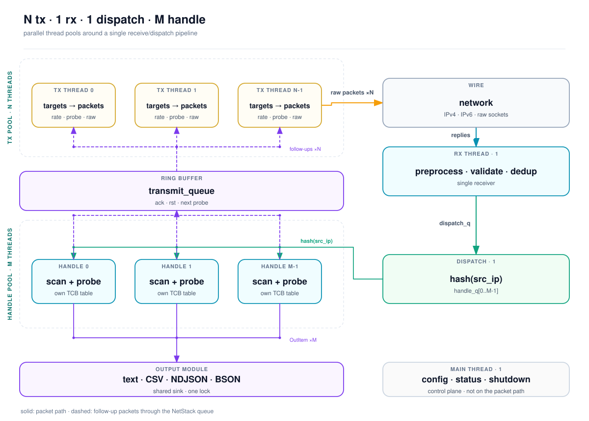
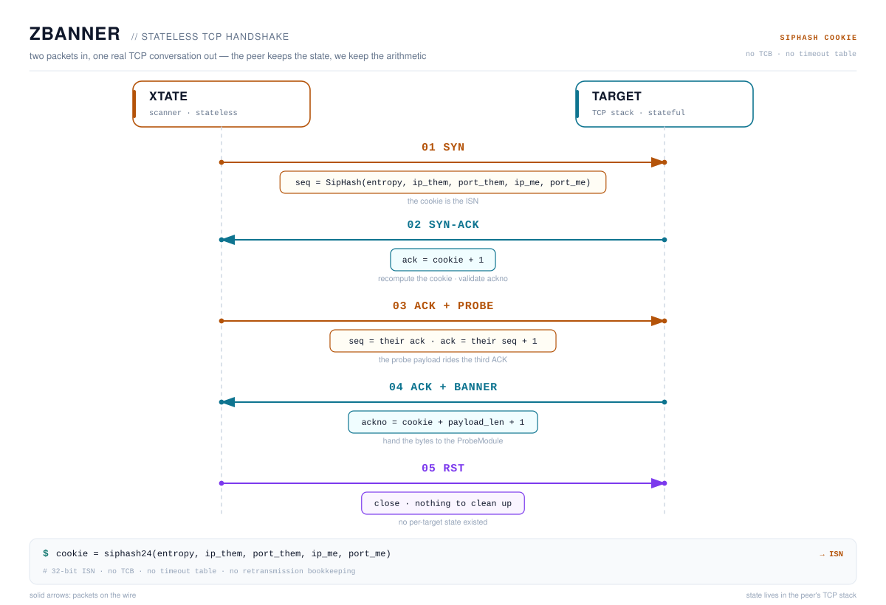

<div align="center">
  
  <br>

  <h3>Xtate —— 面向互联网级测量的模块化全栈网络扫描器</h3>

  <p>
    <b>无状态 TCP banner。</b> <b>混合状态 TCP/TLS。</b> <b>83 个已注册模块。</b><br>
    <sub>C99 · Linux &amp; Windows · IPv4 &amp; IPv6 · 数据包优先，从不做爬虫</sub>
  </p>

  <p>
    <a href="https://github.com/babycoff/xtate"></a>
    <a href="LICENSE"></a>
    <a href="https://github.com/babycoff/xtate"></a>
    <a href="https://github.com/babycoff/xtate"></a>
    <a href="https://github.com/babycoff/xtate"></a>
    <a href="https://github.com/knownsec/404StarLink"></a>
    <a href="https://arxiv.org/abs/2405.07409"></a>
  </p>
</div>

[English](README.md) · **中文**

> **God is Stateless.** —— Xtate 的格言

Xtate 是一款面向大规模主动测量的网络扫描器。它把扫描栈拆成四种可插拔的模块类型——**扫描**（L3/L4 数据包）、**探测**（L5 及以上载荷与解析器）、**生成**（目标）和**输出**（结果）——并自带两个原创引擎：

- **ZBanner** 无需保存每个目标的连接状态，也能拿到真实的 TCP 响应。
- **HLTCP** 是一个混合状态的用户态 TCP 协议栈；当无状态方式不够用时，它负责完成 TLS 握手并获取 HTTPS 响应。

它不是爬虫，也从不假装是。它是一台数据包引擎，只保留刚好够用的协议状态，从而拿到多数高速扫描器拿不到的答案。

<p align="center">
  <a href="#为什么选择-xtate">为什么</a> ·
  <a href="#快速开始">快速开始</a> ·
  <a href="#架构">架构</a> ·
  <a href="#模块">模块</a> ·
  <a href="#构建">构建</a> ·
  <a href="#探索-cli">CLI</a> ·
  <a href="docs/zh-CN/README.md">文档</a> ·
  <a href="#论文与引用">论文</a> ·
  <a href="#许可证与负责任使用">许可证</a>
</p>

## 为什么选择 Xtate

多数高速扫描器止步于“端口开放”，多数服务扫描器在互联网规模下力不从心。Xtate 就活在这两者的交集里。

- ⚡ **ZBanner**——无需为每个目标维护连接表，也能拿到真实的 TCP 响应。状态由对端的 TCP 协议栈保存，一个 SipHash cookie 就能证明这条回应是给你的。
- 🧬 **HLTCP**——按需创建的混合状态用户态 TCP 协议栈。它能完成 TLS 握手，并在握手之上直接讲 HTTP。
- 🧩 **模块**——11 个扫描模块 / 60 个探测模块 / 7 个输出模块 / 5 个生成模块。四套接口，一条流水线，没有运行时的插件魔法。

## 快速开始

```bash
# Linux: build from source (dependencies are covered under Build)
git clone https://github.com/babycoff/xtate.git
cd xtate
./build.sh

# A classic SYN scan — no firewall tricks needed
sudo ./bin/xtate -ip 192.168.1.0/24 -p 80,443 -scan tcp-syn -rate 1000
```

要做真正的 banner 抓取握手，得先让 Linux 内核不再重置它不认识的连接：

```bash
./firewall/add_rules.sh
sudo ./bin/xtate -ip 192.168.1.0/24 -p 80,8080 -scan zbanner -probe http -show info
./firewall/rm_rules.sh
```

> [!TIP]
> 从 `-rate 1000` 起步，而不是 `-rate 1000000`。实验室网段不是互联网，你的交换机会感谢你。

> [!WARNING]
> Xtate 发送原始数据包。请只扫描你拥有、或已获得明确授权测试的网络。未经授权的扫描在你所在地区可能违法。

在 Windows 上，安装 [Npcap](https://npcap.com/)，用 CMake 构建，并在管理员权限的终端中运行 `xtate.exe`。参见[构建](#构建)。

<details>
<summary><b>更多可尝试的命令</b></summary>

```bash
# Stateless TLS hello: grab ServerHello hints without a full handshake
sudo ./bin/xtate -ip 10.0.0.0/24 -p 443 -scan zbanner -probe tls-hello -show info

# UDP with a generic echo probe
sudo ./bin/xtate -ip 10.0.0.0/24 -p u:80 -scan udp -probe echo -show info

# LAN ARP sweep
sudo ./bin/xtate -ip 192.168.1.0/24 -scan arp-req -lan

# IPv6 neighbor discovery on a local link
sudo ./bin/xtate -ip fe80::1/120 -scan ndp-ns -src-ip fe80::2 -fake-router-mac

# SCTP INIT scan
sudo ./bin/xtate -ip 10.0.0.0/24 -p s:38412 -scan sctp-init -show info
```

</details>

## 架构

<p align="center">
  
</p>

每个分片一个 Tx 线程，遍历目标空间，向 ScanModule 索取数据包，再交给当前最快的 raw 发送路径。一个 Rx 线程负责解析、校验并去重回应，然后按目标 IP 分发，保证同一台主机总是落到同一个处理线程上。

- **Tx：** N 个线程；目标生成、速率控制、数据包构造、raw 发送。
- **Rx：** 1 个线程；预处理、校验、去重、可选 pcap 抓包，然后分发。
- **处理（Handle）：** M 个线程；扫描/探测状态机、结果格式化、后续数据包。
- **有状态扫描：** 每个处理线程一张 TCP 连接表，因此热路径无需加锁。

处理线程通过无锁环形队列，把后续数据包（ACK、RST、下一次探测）注回 Tx；正因如此，“无状态”的 Rx 路径依然能驱动一次真正的 TCP 会话。

**简单说说底层：**

- 数据包模板在启动时预先生成，之后按目标逐字段打补丁，并重新计算校验和。
- 目标空间被展平成 `ip × port`，再用 BlackRock 置换；源 IP 和源端口同样可以随机化（63 位扫描空间）。
- 结果是一个 `OutItem`，内含三条带类型的键值链（scan、probe、output），流式交给所选的 OutputModule。
- `--pcap`、`--resume`、`--shard` 和实时状态栏都是内置功能。

## 两种扫描方式

| | **ZBanner**（无状态） | **HLTCP**（混合状态） |
|:---|:---|:---|
| 每个目标的状态 | 无 | 收到 SYN-ACK 后建立 TCB |
| 我方发送 | SYN + 携带探测载荷的 ACK | 完整的 TCP 状态机 |
| 你能得到 | 开放/关闭 + 首条 banner | TLS 握手、证书、密码套件、TLS 之上的 HTTP |
| 内存占用 | 仅去重表 | 小型 TCB；TLS 会话的内存开销与 OpenSSL 相当 |
| 适用场景 | 互联网范围的 banner 普查 | 对感兴趣主机的定向取证 |
| 入口 | `-scan zbanner -probe <tcp>` | `-scan tcp-state -probe <state>` |

招牌技巧，一条时序就能讲完：

<p align="center">
  
</p>

没有 TCB，没有超时表，也没有重传记录。只有一点算术，而对端的 TCP 协议栈会帮你验证它。当这还不够时，`tcp-state` 接手，由 HLTCP 保留真正的 TLS/HTTP 会话所需的最小状态。

## 模块

下面的数量基于启用全部可选依赖的完整构建；缺少对应库的模块会直接消失。

### 扫描模块（11）

| 模块 | 探测 | 作用 |
|:---|:---:|:---|
| `tcp-syn` | — | 经典 SYN 扫描，用 SipHash cookie 作 ISN；可选 `--send-rst`。 |
| `udp` | UDP | 发送 UDP 载荷并校验响应。 |
| `zbanner` | TCP | 无状态 TCP 握手；载荷挂在第三个 ACK 上；抓取 banner。 |
| `tcp-state` | STATE | HLTCP 有状态 TCP；与 TLS/HTTP 状态探测配合使用。 |
| `icmp-echo` | — | ICMP echo 主机发现；可记录 TTL 和 IPID。 |
| `icmp-time` | — | ICMP 时间戳扫描。 |
| `sctp-init` | — | SCTP INIT 扫描。 |
| `arp-req` | — | LAN 模式下的二层 ARP 扫描。 |
| `ndp-ns` | — | IPv6 NDP 邻居请求。 |
| `yarrp-echo` | — | 用 ICMP echo 做无状态拓扑探测。 |
| `yarrp-udp` | — | 用 UDP + ICMP 错误包做无状态拓扑探测。 |

### 探测模块（60）

- **通用：** `http`（+ 状态）、`hello`（+ UDP/状态）、`tls-hello`、`tls-state`、`dns`、`snmp`、`echo`、`jarm`。
- **指纹识别：** `recog`（+ UDP/状态，Recog XML）、`nmap`（+ UDP，nmap-service-probes）、`lzr`（一个聚合器背后 38 种协议握手）。
- **可脚本化：** `lua-tcp`、`lua-udp`——丢一个 Lua 脚本进去，你就有了一个探测。
- **基础件：** `get-state`、`close-state`、`null`。

### 输出与生成模块

- **输出：** `text`、`csv`、`ndjson`、`bson`、`mongodb`、`list`、`null`。
- **生成：** `blackrock`（默认，无状态置换）、`ip-list`、`addr-list`、`ip-stream`、`addr-stream`。

自己写模块刻意保持朴素：每个模块就是一个 struct，再加 NULL 结尾的注册表里的一行；同一份元数据即可驱动 `--help-*`、参数解析、模糊搜索和交互式补全。可以在 [`src/scan-modules/scan-modules.c`](src/scan-modules/scan-modules.c) 及同类文件中找 `REGISTER YOUR ... MODULE HERE` 字样。

## 文档

README 是落地页，手册在 [`docs/`](docs/zh-CN/README.md) 目录下：

- [快速上手](docs/zh-CN/getting-started.md)——构建、权限、首次扫描、防火墙
- [目标与端口](docs/zh-CN/targets-and-ports.md)——IPv4/IPv6 输入、文件、ASN、排除、分片
- [扫描模式](docs/zh-CN/scanning-modes.md)——无状态与有状态、扫描/探测配对、常用配方
- [输出](docs/zh-CN/output.md)——结果级别、格式、MongoDB
- [模块](docs/zh-CN/modules.md)——四种模块类型以及 Xtate 自带的模块
- [架构](docs/zh-CN/architecture.md) · [ZBanner](docs/zh-CN/zbanner.md) · [HLTCP](docs/zh-CN/hltcp.md)
- [故障排查](docs/zh-CN/troubleshooting.md) · [已知限制](docs/zh-CN/known-limitations.md)

英文文档：[`docs/`](docs/README.md)

## 构建

### Linux

```bash
sudo apt install build-essential cmake pkg-config libpcap-dev \
  libssl-dev libpcre2-dev libxml2-dev libbson-dev libmongoc-dev
./build.sh                 # release build → bin/xtate
./build.sh debug clang     # debug build with Clang
```

Ubuntu 22.04/24.04 是参考环境。在 Fedora/Arch 上，请安装对应的开发包（`libpcap`、`openssl`、`pcre2`、`libxml2`、`libbson`、`mongo-c-driver`）。

PCRE2 的发现优先使用 CMake 包配置；在 Debian/Ubuntu 上会回退到 `pkg-config`，因此需要同时安装 `libpcre2-dev` 和 `pkg-config`。

推荐的编译器：GCC、Clang、MSVC 和 MinGW-w64。Xtate 要求 64 位小端主机；不满足时 CMake 会提前终止。

<details>
<summary><b>Windows 构建</b></summary>

安装 **Npcap**（运行时）、CMake，以及 Visual Studio 2022/2026 或 MinGW-w64。完整平台/工具链矩阵和问题排查见[快速上手](docs/zh-CN/getting-started.md)。

可选依赖可以用 Scoop 安装（MSVC/clang-cl）：

```powershell
scoop install openssl-lts lua54
```

Scoop 没有 PCRE2、libbson 或 libmongoc；需要完整 probe/output 集合时用 vcpkg，或接受较少的模块。

MSVC：

```powershell
cmake -S . -B build-msvc -G "Visual Studio 17 2022" -A x64 `
  -DOPENSSL_ROOT_DIR="$env:USERPROFILE\scoop\apps\openssl-lts\current"
cmake --build build-msvc --config Release -j 8
```

MinGW：

```powershell
cmake -S . -B build-mingw -G "MinGW Makefiles" `
  -DCMAKE_C_COMPILER=gcc -DCMAKE_BUILD_TYPE=Release
cmake --build build-mingw -j 8
```

也可以用 `scripts\build-windows.ps1` 一次构建整套矩阵；脚本会在复制源码到 ASCII 中转目录前询问，并在构建后清理中转目录。

Npcap 是报文收发的必需项；`wpcap.dll` 在运行时加载。
</details>

<details>
<summary><b>可选依赖及其解锁的功能</b></summary>

| 依赖 | 解锁 | 开关 |
|:---|:---|:---|
| OpenSSL ≥ 1.1.1 | `tls-state`、`jarm`、TLS 相关探测 | `-DWITH_OPENSSL=OFF` |
| PCRE2（8 位） | `hello`、`http`、`recog`、`nmap` 中的正则匹配 | `-DWITH_PCRE2=OFF` |
| LibXml2 | Recog XML 指纹文件 | `-DWITH_LIBXML2=OFF` |
| libbson / libmongoc | BSON 和 MongoDB 输出 | `-DWITH_BSON=OFF`、`-DWITH_MONGOC=OFF` |
| libpcap / Npcap | 数据包 I/O（运行时） | 动态加载 |
| PF_RING | Linux 上的零拷贝数据包 I/O（运行时） | 可选 |
| Lua 5.3/5.4 | `lua-tcp`、`lua-udp`（运行时） | 可选 |

缺少可选库只会在编译时移除相应模块——核心扫描器仍可正常构建。
</details>

> [!NOTE]
> 原始套接字在 Linux 上需要 root，在 Windows 上需要管理员权限。在 Linux 上，如果你清楚自己在做什么，可以用 `sudo setcap cap_net_raw,cap_net_admin=eip ./bin/xtate` 来替代每次运行都加 `sudo`。

## 探索 CLI

```bash
xtate --usage                 # short usage and examples
xtate --help                  # every global parameter
xtate --intro                 # the architecture tour
xtate --list-scan             # 11 scan modules
xtate --list-probe            # 60 probe modules
xtate --list-out              # 7 output modules
xtate --list-gen              # 5 generate modules
xtate --help-scan zbanner     # module-specific parameters
xtate --interact              # interactive shell with tab completion
```

## 论文与引用

Xtate 的两个引擎源自我们的研究：

- **ZBanner: Fast Stateless Scanning Capable of Obtaining Responses over TCP**——[arXiv:2405.07409](https://arxiv.org/abs/2405.07409) · [IPCCC 2024](https://doi.org/10.1109/IPCCC59868.2024.10850469)
- **Efficient Application-Layer Scanning with Hybrid-State Lightweight TCP Stack for TLS-based Service Monitoring**——[ICCT 2024](https://doi.org/10.1109/ICCT62411.2024.10946306)
- **硕士学位论文：** *Research on Technologies of Network Protocol and Device Identification Based on Application-Layer Scanning*（NUDT，2024）

<details>
<summary><b>BibTeX</b></summary>

```bibtex
@misc{chen2024zbanner,
  title         = {ZBanner: Fast Stateless Scanning Capable of Obtaining Responses over TCP},
  author        = {Chen, Chiyu and Lu, Yuliang and Yang, Guozheng and Xie, Yi and Guo, Shasha},
  year          = {2024},
  eprint        = {2405.07409},
  archivePrefix = {arXiv},
  primaryClass  = {cs.NI}
}

@inproceedings{chen2024hltcp,
  title     = {Efficient Application-Layer Scanning with Hybrid-State Lightweight TCP Stack for TLS-based Service Monitoring},
  author    = {Chen, Chiyu and Lu, Yuliang and Yang, Guozheng and Xie, Yi and Guo, Shasha},
  booktitle = {2024 IEEE 24th International Conference on Communication Technology (ICCT)},
  pages     = {2067--2073},
  year      = {2024},
  doi       = {10.1109/ICCT62411.2024.10946306}
}
```
</details>

如果 Xtate 对你的研究有帮助，一次引用比一个 star 更让我们高兴。

## 许可证与负责任使用

AGPL-3.0。见 [LICENSE](LICENSE)。如果你把修改过的 Xtate 作为网络服务运行，AGPL 的网络使用条款就会生效。

> [!WARNING]
> Xtate 是用于测量与安全研究的双用途工具。请只在你自己拥有、或已获得书面许可测试的网络上使用。遵守当地法律、ISP 政策以及目标网络的规则，是你的责任。

Xtate 起源于 [Masscan](https://github.com/robertdavidgraham/masscan) 的代码库；感谢 Robert Graham 以及源码中提到的所有上游项目。Xtate 是 [404Starlink](https://github.com/knownsec/404StarLink) 的成员。

作者 **Alvin Chen**（陈驰昱）· [shineccy@aliyun.com](mailto:shineccy@aliyun.com)。最初的代码写于他在国防科技大学攻读硕士期间，以及安徽省网络空间安全态势感知与评估重点实验室。

<div align="center">
  <sub>God is Stateless. 物理层？我们止步于网线。</sub>
</div>
