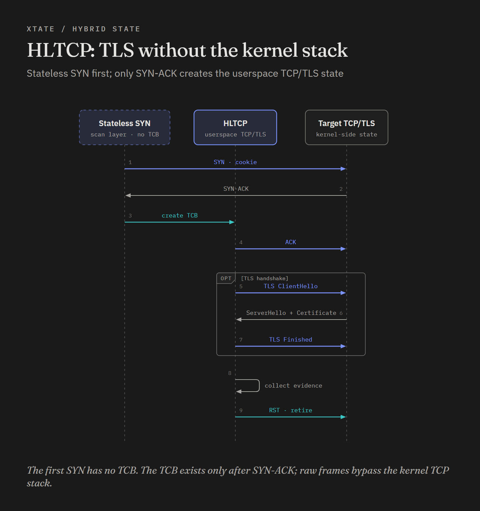

# HLTCP: hybrid-state TCP and TLS

**English** · [中文](zh-CN/hltcp.md)

ZBanner answers one question per target and reads the first answer. Some questions need a
conversation: complete a TLS handshake, read the certificate chain, send an HTTP request
inside the tunnel, read the response. That requires a real TCP state machine on our side,
and a state machine per target is exactly what large-scale scanning cannot afford.

> [!WARNING]
> **Linux host firewall rules are mandatory for HLTCP.** `tcp-state`, `tls-state`, HTTP/2 and all state sub-probes use raw TCP. Without `./firewall/add_rules.sh`, the kernel RSTs half-open connections and the probe reports `open` but no banner/TLS/probe output. This is not ZBanner-only. See [Getting started](./getting-started.md#banner-and-stateful-scans-stop-the-kernel-from-answering).

HLTCP is the compromise. It is a user-space TCP stack — "hybrid-state lightweight TCP" in
the source's own words — that **keeps no state while it is only sending SYNs**, and allocates
a connection control block only after a target has proven it will talk. You pay memory for
connections that exist, not for targets that were probed.

See [architecture.md](./architecture.md) for the thread model this stack lives in, and
[zbanner.md](./zbanner.md) for the stateless alternative.

## What "hybrid-state" actually means

- **SYN phase: stateless.** The initial sequence number is a SipHash cookie of the connection
  tuple, the same construction ZBanner uses. Nothing is stored. When a SYN-ACK arrives, the
  cookie is recomputed from the packet's own fields and compared with `ackno - 1`. If they
  match, this is our connection — and only now is a TCB allocated.
- **After the SYN-ACK: stateful.** Everything that cannot be recovered from a single packet
  lives in the TCB: the four-tuple, both sequence numbers, the unacknowledged segment, the
  MSS, the connection age, the probe's private session state and one timeout entry.

A dropped SYN therefore leaves no trace at all: no entry to time out, no retransmission
attempted. That exchange of reliability for footprint is the core of the design.

What the stack keeps is roughly "anything that spans more than one packet". It discards
`LISTEN`, `SYN_RCVD`, `FIN_WAIT*`, `CLOSE_WAIT`, `LAST_ACK` and `TIME_WAIT`; out-of-order
queues; receive buffers; RTT estimation and congestion control; send-window management; and
half-close semantics. Data is acknowledged segment by segment instead of against a window.

## The state machines

Three TCP states, five application states, five events:

| TCP state | Meaning | Application state | Meaning |
|:---|:---|:---|:---|
| `SYN_SENT` | Initial value; a TCB never lingers here | `INIT` | Just created |
| `SENDING` | Unacknowledged data outstanding | `RECV_HELLO` | Waiting for the server to speak first |
| `RECVING` | Waiting to receive | `RECVING` | Waiting for payload |
| | | `SEND_FIRST` | Our turn to send the first bytes |
| | | `SENDING` | An application send is in flight |

Events are `CONNECTED`, `RECV_TIMEOUT`, `RECV_PAYLOAD`, `SENDING` and `SEND_SENT`. The two
machines are deliberately separate: TCP state answers "is there data in flight", application
state answers "whose turn is it to talk".

## Connection lifecycle

```
tx:  SYN(seq=cookie, ack=0)
rx:  SYN-ACK(seq=s, ack=cookie+1) -> validate ackno-1 == cookie
     handle: record open; create TCB(seqno_me=ack, seqno_them=s+1)
     stack:  send ACK; TCP state -> RECVING; conn_init(); notify CONNECTED
app:  SEND_FIRST -> make_hello() -> DataPass -> send_data()
     head segment goes out immediately as PSH|ACK
peer: ACK retires the segment; when the queue empties, SEND_SENT -> RECVING
peer: DATA -> duplicate prefix trimmed, seqno_them advances, one ACK per segment
     -> parse_response(); if the probe returns data, send it; if is_close, close
```

A RST from the peer destroys the TCB immediately. A FIN is answered with a RST rather than a
FIN/ACK — there is no `TIME_WAIT` and no graceful close. A connection older than its expiry
is sent a RST and destroyed, and so is a connection whose probe asks to close. Destroyed
TCBs go back to a free list and are reused, but the memory is never returned to the OS while
the process runs.

## TLS on top of HLTCP

TLS is the reason this stack exists, and it is implemented by handing the byte stream to
OpenSSL rather than by parsing records ourselves.



- **One `SSL_CTX`, configured once.** `TLS_method()`, no peer verification, no min/max
  protocol version, security level 0, `ALL:eNULL` ciphers, every TLS 1.3 suite. The context
  disables the client session cache, session tickets and renegotiation: a one-shot scan has
  no reuse for them and they only add per-connection state. This is not a safe TLS client
  and is not meant to be one; it is configured to observe what servers say, with a deliberate
  compatibility trade: servers that require legacy renegotiation are not supported.
- **Per connection:** two `BIO_s_mem()` BIOs (one read, one write), a 4 KiB scratch buffer, an
  `SSL` object, and a copy of the target so OpenSSL callbacks can recover it.
  `SSL_set_connect_state` makes it a client; `SSL_set_bio` wires the memory BIOs.
- **Driving the handshake.** `SSL_do_handshake()` returns `WANT_READ` and deposits the
  ClientHello in the write BIO; HLTCP sends those bytes as TCP payload. Each arriving segment
  is written to the read BIO and the handshake is driven again. Outgoing bytes are drained
  from the write BIO; incoming plaintext only matters once the handshake finishes.
- **What gets recorded.** Negotiated TLS version, cipher suite, the peer certificate chain
  (base64, one field per certificate), subject and subject alternative names, and TLS alerts
  surfaced through OpenSSL's info callback.
- **After the handshake** the TLS probe becomes a transport for a nested application probe.
  Plaintext from the sub-probe is `SSL_write`-encrypted and drained as TCP data; arriving
  ciphertext is `SSL_read`-decrypted and handed to the sub-probe. The nested HTTP probe has
  no idea TLS exists — it composes an HTTP request and parses an HTTP response.

### SNI and ALPN are opt-in

By default the TLS state probe sends no server name indication (SNI) and no ALPN protocol
list, so every handshake is addressed to the IP address rather than to a hostname. On shared
hosting and CDNs this returns the default certificate and default virtual host, which may
belong to an entirely different site than the one you think you are probing.

Because Xtate targets are IP addresses, there is no hostname to derive automatically. The
stateful probe therefore takes one explicit name for the whole run:

```bash
sudo ./bin/xtate -ip 203.0.113.10 -p 443 -scan tcp-state -probe tls-state \
  -probe-arg "-subprobe close-state -sni www.example.com -alpn h2,http/1.1 --dump-cert" \
  -rate 100 -show info
```

- `-sni <hostname>` sets one SNI name for **every** target in that run. Use it when the
  target IPs belong to one CDN/virtual host; use separate runs for different hostnames.
- `-alpn <list>` accepts a comma/space-separated protocol list (`h2,http/1.1`), preserving
  order. Leave it unset to omit the ALPN extension.
- This is a `tls-state` option, not a global target/hostname resolver. It does not perform
  reverse DNS and does not magically learn the vhost from the IP.
- The stateless `tls-hello` and `jarm` probes keep their existing fixed extension behaviour;
  their SNI/ALPN are not controlled by these stateful flags.

A per-IP/CIDR hostname map is a possible future extension (longest-prefix match), but is not
implemented yet. For mixed vhosts today, run one SNI value per invocation.

`-rate` remains a **wire-packet rate**, not a connections/s rate. HLTCP can send a SYN,
ACK+probe, several TLS records, retransmissions and a FIN/RST for one target; the exact
count depends on the probe/subprobe, target behaviour and retransmission policy. The bucket
sizing above uses `rate / 5 / handlers` only as a heuristic; it is not a target-rate formula.
See [Rate is not target rate](./scanning-modes.md#rate-is-not-target-rate).

## Probe nesting and DataPass

State probes compose:

```
tcp-state -> tls-state -> http-state / hello-state / recog-state / get-state / close-state
```

The outer scan module is `tcp-state`. The probe is `tls-state`, which names its own inner
probe with `-subprobe` and passes that probe's arguments with `-subprobe-arg`:

```bash
--probe-arg "-subprobe http-state -subprobe-arg '--all-banner'"
```

`tls-state` refuses a sub-probe that is not state-typed. Multi-slot plans are a
ZBanner/TCP feature; the stateful TLS layer runs one sub-probe flow.
Lifecycle callbacks nest too: the sub-probe's connection init runs **after the TLS handshake
succeeds**, immediately before its `make_hello`; its close runs only if that init happened,
before the `SSL` object is freed.

The glue between layers is **DataPass** (`data`, `len`, `is_dynamic`, `is_close`).
`is_dynamic` is an ownership flag: static data (`0`) is a constant the sender promises will
not change before transmission and the lower layer must not free, while dynamic data (`1`)
has been copied to the heap and ownership passes down with it, so every layer may reuse its
own scratch buffer. `is_close` asks the TCP layer to close after sending. Because every layer
reads and writes the same struct, a TLS probe and an HTTP probe can be written independently.

Two rough edges: the sub-probe's `conn_init` runs at TCB creation, before the TLS handshake
completes (the source marks this as a `FIXME`), and no shipped state probe sets a non-zero
`hello_wait`, so the "wait for the server to speak first" application state is effectively
unused.

## Memory and concurrency

Each handler thread owns **its own TCP connection table**. Because dispatch hashes the source
IP, a connection is only ever handled by one thread, so the hot path takes no locks. That is
the design's central concurrency claim, and it holds as long as the handler count stays fixed
for the duration of the scan.

| Item | Cost |
|:---|:---|
| TCB plus one unacknowledged segment | A few hundred bytes |
| Hash bucket array | 8 bytes per bucket, sized from the scan rate |
| Timeout wheel | About 8 MiB per table, fixed, independent of connection count |
| Packet buffer pool (global) | 16384 buffers of 2048 bytes, about 32 MiB |
| TLS session | OpenSSL `SSL`, session and peer chain: several KB to tens of KB |

The last row dominates: pure TCP state is cheap, a TLS connection is not, and more than 85%
of the per-connection cost is OpenSSL. This engine is for targeted evidence on interesting
hosts, not for a TLS census of the Internet.

The per-connection TLS scratch buffer doubles on demand but is capped at **1 MiB**; if a
flight would need more, the connection is closed and a warning is logged instead of allowing
unbounded memory growth. Each TLS connection also has a 16 MiB encrypted-input budget, a
256 KiB pending-BIO cap and a 256 KiB certificate-chain cap. Exceeding any of them closes that
connection.

Table sizing is a guess, not a budget: roughly `rate / 5 / handlers` buckets, rounded up to a
power of two, floored at ten and clamped between 2^10 and 2^24. Each table also has an
active-TCB budget of `min(2 x buckets, 16 MiB / sizeof(TCB))` with a floor of 1024. A total
budget across all handler tables defaults to **128 MiB** and can be changed with
`-scan-arg "--tcb-mem=<MiB>"` (1..4096). When a table budget is exhausted, a new SYN-ACK is
still reported as open, but no probe state is created for it; the connection is dropped and
counted. Status prints `tcb=<active>/<limit> drop=<dropped>`. Pooled TCBs keep peak memory
resident, but cannot exceed the table/global budget.

## Capacity and timeouts

- **Connection expiry:** 30 seconds by default (`-scan-arg "--conn-expire 30"`); the stack then sends a RST
  and reclaims the TCB.
- **Retransmission:** a fixed 1-second RTO resends the head unacknowledged segment. There is
  no RTT estimate, no backoff, and no retransmission of SYNs or of pure ACKs.
- **One timer slot per TCB**, re-armed every second while the connection is active. RTO and
  expiry share it, so the two behaviours overwrite each other's schedule.
- **Receive window:** the non-SYN TCP template advertises 1024 bytes by default, which makes
  the peer send many small segments. Raising `--tcp-win` (and adjusting `--max-pkt-len`) is
  the first thing to try if a scan feels slow — the module's own help text says as much.
- **Probe slots:** ZBanner/TCP slot plans encode the slot in the source port; HLTCP itself
  runs a single stateful flow, so a multi-slot plan does not apply to `tcp-state`.

## STARTTLS

`tls-state --starttls smtp|imap|pop3|ftp` performs the plaintext greeting and
upgrade command before the TLS handshake:

- SMTP: `220` greeting, `EHLO`, `STARTTLS`, `220`;
- IMAP: `* OK`, `a001 STARTTLS`, `a001 OK`;
- POP3: `+OK`, `STLS`, `+OK`;
- FTP: `220`, `AUTH TLS`, `234`.

After the upgrade, `--dump-cert-details` and subprobes work as on a direct TLS
port. The subprobe is initialized **after** the TLS handshake and only sees the
encrypted stream, never the plaintext STARTTLS exchange. A failed plaintext
negotiation is emitted as `starttls error` and the subprobe is not initialized.

```bash
# Certificate only, after SMTP STARTTLS
sudo ./bin/xtate -ip 203.0.113.10 -p 25 -scan tcp-state -probe tls-state \
  -probe-arg "-subprobe close-state --starttls smtp --dump-cert-details" \
  -rate 100 -show info

# Certificate only, after IMAP STARTTLS
sudo ./bin/xtate -ip 203.0.113.10 -p 143 -scan tcp-state -probe tls-state \
  -probe-arg "-subprobe close-state --starttls imap --dump-cert-details" \
  -rate 100 -show info
```

`close-state` is a valid state subprobe for certificate-only scans: it sends
nothing and closes after the handshake; the certificate item is emitted before
subprobe initialization.

## Certificate details

`tls-state --dump-cert-details` emits structured `cert_subject`, `cert_issuer`,
`cert_not_before`, `cert_not_after`, `cert_serial`, `cert_signature_algorithm`,
`cert_public_key`, `cert_public_key_bits`, `cert_san`, `tls_version`,
`tls_cipher` and negotiated `tls_alpn`.

## Usage

```bash
# The kernel must not reset connections it does not know about (same as ZBanner)
./firewall/add_rules.sh
# TLS evidence: version, cipher, certificate chain (tls-state needs a state sub-probe)
sudo ./bin/xtate -ip 10.0.0.0/24 -p 443 -scan tcp-state -probe tls-state \
  --probe-arg "-subprobe close-state --dump-version --dump-cipher --dump-cert" -show info
# HTTPS: complete TLS, then speak HTTP inside the tunnel
sudo ./bin/xtate -ip 10.0.0.0/24 -p 443 -scan tcp-state -probe tls-state \
  --probe-arg "-subprobe http-state -subprobe-arg '--all-banner'" -show info
# A plain TCP conversation with no TLS
sudo ./bin/xtate -ip 10.0.0.0/24 -p 80 -scan tcp-state -probe http-state -show info
./firewall/rm_rules.sh
```

Module-specific options travel through `--scan-arg` (for `tcp-state`) and `--probe-arg` (for
the probe). For example `-scan-arg '--conn-expire 15 --record-all-ttl'` shortens the
connection lifetime and records packet-level detail on every segment; per-module options are
listed by `--help-probe` and `--help-scan`.

## Retry bounds and deliberate simplicity

HLTCP is a short-lived, low-state stack, not a general-purpose TCP. The only
retransmission hardening is a bounded retry budget:

- a data segment is retransmitted at most `TCP_CORE_MAX_DATA_RETRIES` (3) times;
  on exhaustion the connection is RST and the TCB is released;
- a SYN attempt in the normally-unreachable `SYN_SENT` branch is capped at
  `TCP_CORE_MAX_SYN_RETRIES` (3), purely as a guard; `tcp-state` creates its TCB
  only after a SYN-ACK, so the initial SYN is still not retransmitted by this
  path;
- the retry counter resets when an ACK advances the send queue or a new data
  burst starts.

Deliberately **not** implemented:

- SRTT/RTTVAR-based RTO estimation (fixed 1-second RTO);
- exponential backoff;
- out-of-order reassembly queues;
- local fast retransmit/SACK;
- congestion control or per-segment timers.

Those add per-connection memory, per-packet work, or protocol state that HLTCP
does not need for short probes. Out-of-order data is ACKed with the expected
sequence and dropped; the peer's own TCP can fast-retransmit it. Completeness is
explicitly allowed to lose to memory/CPU predictability and scan throughput.
For a target where this is not acceptable, re-run it or use a full TCP stack.

## Known limitations

- **No SYN retransmission.** A TCB only exists after a SYN-ACK, so the `SYN_SENT` timeout
  branch can never fire. A lost SYN is a silent miss — re-run the scan, or narrow it to
  higher-value targets.
- **Duplicate/lost-ACK repair is partial.** A retransmitted SYN-ACK is answered with a fresh ACK, and duplicate old data or a future segment triggers an immediate ACK of the expected sequence. The peer can then retransmit sooner; there is still no general ACK-repair state machine for arbitrary lost ACKs.
- **No out-of-order handling.** Data beyond the expected sequence number is dropped and not buffered; the immediate ACK tells the peer what we expect, but large certificate chains and multi-segment TLS flights still depend on peer retransmission.
- **Fixed 1-second RTO, no backoff.** Retransmits eagerly on high-latency paths. Data retransmissions are capped at three; exceeded connections are closed with RST.
- **No TLS session reuse, tickets or renegotiation.** The one-shot TLS context disables all
  three to avoid per-connection state. A server that requires legacy renegotiation is treated
  as unsupported.
- **No graceful close by default.** FIN is answered with RST, there is no `TIME_WAIT`, and
  TLS sends no `close_notify`. Targets see an abnormal termination — acceptable for
  scanning, noisy for long-term monitoring. The `tls-state` research switch
  `-probe-arg "--graceful-tls-close"` sends a TLS `close_notify` before the RST; it costs an
  extra packet/round trip and is not recommended for normal scanning.
- **Closed ports are reported at `info` level.** A RST matching no TCB is emitted as
  `"closed" because "rst"`; the scanner's dedup table suppresses repeated RSTs. Without
  `-show info`, these rows stay hidden.
- **SNI/ALPN are opt-in.** By default virtual-host and CDN targets return the default
  certificate; set `-sni`/`-alpn` on `tls-state` when the target IPs belong to one known
  hostname.

## Deliberately out of scope

These are design decisions, not TODO items:

- **SYN retransmission, RTT-adaptive RTO, out-of-order buffering.** A TCB only exists after
  a SYN-ACK, so SYN retransmission needs a pending-SYN table in the scan layer; RTT needs a
  timestamp per unacknowledged segment; out-of-order buffering needs per-connection memory.
  All three push HLTCP away from its hybrid-state, low-memory model. A bounded data retry
  limit is the only intended hardening; the intended recovery for a lost SYN is a re-run
  (`--repeat`, or another pass), not a per-target retry state machine.
- **General ACK-repair state machine.** Duplicate SYN-ACK and duplicate/future data are
  ACKed where that prevents a 30-second stall, but Xtate does not send speculative pure ACKs
  for every lost acknowledgement. Extra ACK traffic changes almost no scan result and costs
  bandwidth, so this is intentionally not pursued.
- **OpenSSL memory.** Several kilobytes to tens of kilobytes per live TLS connection; this,
  not the TCP stack, sets the memory ceiling.
- **Deduplication is disabled.** `tcp-state` leaves deduplication to the state machine, so
  duplicate-packet behaviour is weaker than ZBanner's.

Details and workarounds for these, together with the ZBanner and platform caveats, are
collected in [known-limitations.md](./known-limitations.md). For choosing an engine, see
[scanning-modes.md](./scanning-modes.md).
